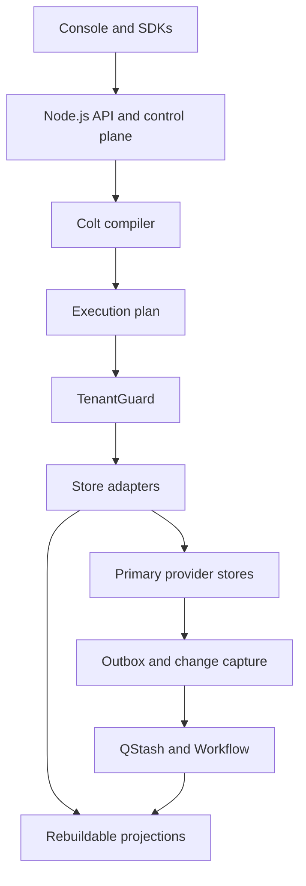

# Architecture

ColtaneDB compiles Colt programs into plans for existing data stores; it does not implement a storage engine.

## Boundaries

- The console and public clients call the API; users never receive provider credentials or direct connection strings.
- The control plane owns authentication, invites, catalog, placement, policies, limits, usage, and audit data.
- The Colt compiler pipeline is source → lexer → parser/AST with spans → semantic checks → planner/capabilities → code generation → execution plan. The compiler never executes a plan.
- Every adapter operation is tenant-scoped through TenantGuard. Postgres uses tenant schemas/roles; code-enforced adapters require adversarial cross-tenant tests.
- Every collection has one primary store. Derived stores are rebuildable; Redis-primary collections are explicitly non-rebuildable from another source.
- Cross-backend links use bounded batched lookups and are not transactional. `ATOMIC` cannot span primaries.
- Sync is at-least-once with idempotent consumers and reconciliation; do not claim exactly-once delivery.
- Long-running tasks use queue/workflow abstractions, not request handlers.

## Runtime and stores

The API runs on Node.js (Hono, Vercel Functions by default, with Docker self-hosting planned). Provider resources are operator-owned and shared; the application provisions only tenant namespaces. Neon is the catalog and default relational primary. Supabase has stricter namespace and backup protections and is blocked until the owner verifies a backup restore. See ADRs 0001–0004 and `docs/RUNBOOK.md`.